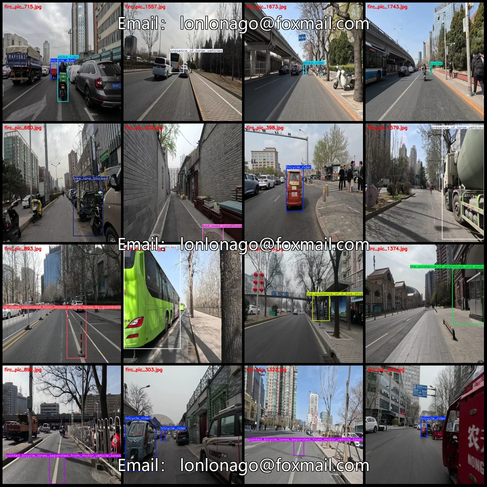
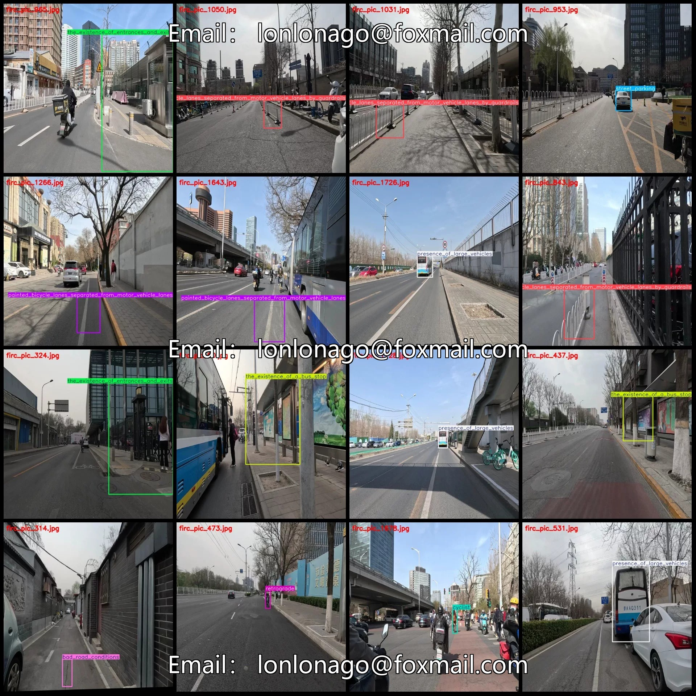
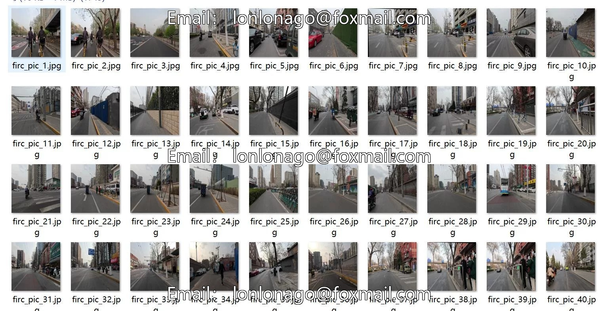
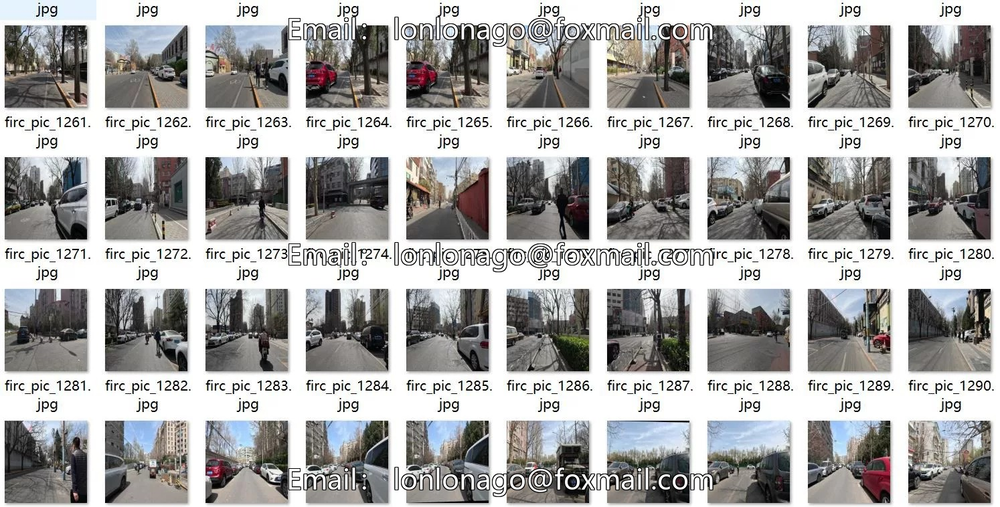
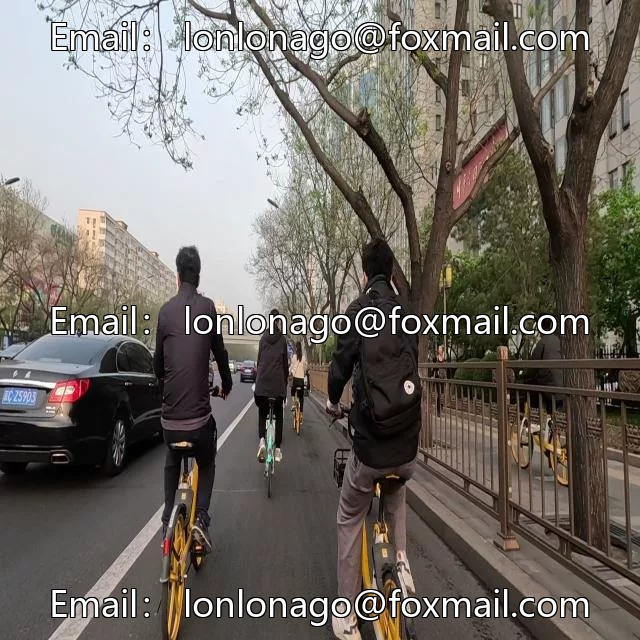
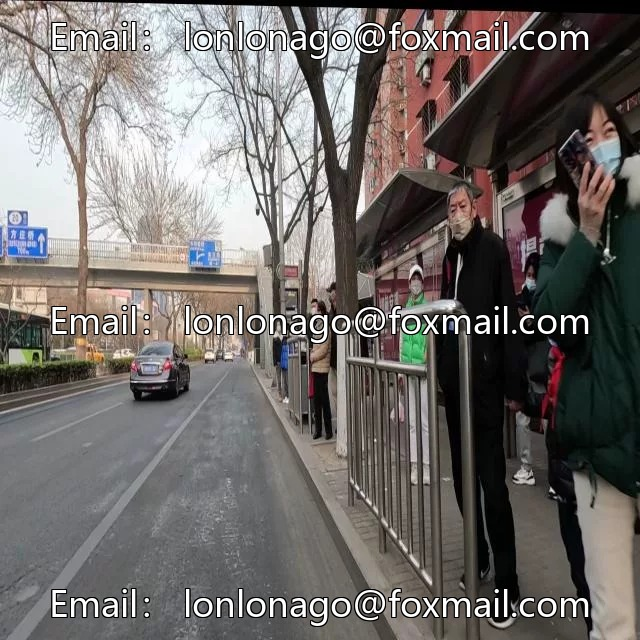
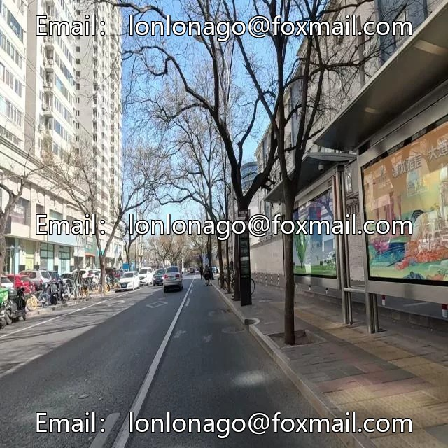

# Rider Risk Detection Dataset VOC+YOLO format with 1745 images in 17 categories

## Body

Rider Risk Detection Dataset VOC+YOLO format: 1745 images in 17 categories
Tips: Due to the dataset's replicability, please confirm compliance before purchasing.
Dataset format: Pascal VOC format + YOLO format (txt file without split path, only containing jpg images and corresponding VOC format xml files and yolo format txt files)
Number of images (number of jpg files): 1745
Number of annotations (number of xml files): 1745
Number of annotations (number of txt files): 1745
Number of annotation categories: 17

Label category names (Note that the order in YOLO format does not correspond to this, but is based on the labels folder's classes.txt): ["bad_road_conditions", "bicycle_lanes_completely_separated_from_motor_vehicle_lanes", "bicycle_lanes_separated_from_motor_vehicle_lanes_by_guardrails", "bike_lane_blocked", "cyclist", "ebike_rider", "no"]

height_difference_between_sidewalks_and_bicycle_lanes","painted_bicycle_lanes_separated_from_motor_vehicle_lanes","presence_of_large_vehicles","retrograde","riding_on_the_sidewalk","street_parking","the_existence_of_a_bus_stop","the_existence_of_entr

ances_and_exits,"the_existence_of_non_bicycle_traffic_entities","tricycle_rider","wearing_a_helmet

Number of boxes and image count per category
Bad Road Conditions (poor road conditions) = 146, Image Count = 95
Bicycle Lanes Completely Separated from Motor Vehicle Lanes (completely separated bicycle lanes from motor vehicle lanes) = 196, Image Count = 196

Bicycle lanes separated from motor vehicle lanes by guardrails (160 frames, 160 images)
bike_lane_blocked (Bicycle lane blocked) Frames = 97, Represents = 73
Cyclist (rider) frame count = 66, occupying picture count = 61
ebike_rider (electric bicycle rider) frame count = 111, occupied image count = 85

No height difference between sidewalks and bicycle lanes (Sidewalks and bicycle lanes have no height difference) Frame count = 99, Image count = 88
Painted bicycle lanes separated from motor vehicle lanes (Lines separate bicycle lanes from motor vehicle lanes) Frame count = 175, Image count = 175
Presence of large vehicles (Large vehicles are present) Frame count = 136, Image count = 123

Retrograde (reverse) frame count = 76, occupying picture count = 73
Riding on the sidewalk (riding on the sidewalk) frame count

## Images

## Payment

Here is a pay link on Stripe ( https://buy.stripe.com/3cs8yP7sY87d0vu9AB ). Please contact me lonlonago@foxmail.com after funding $89, and I will send you a complete data files , thank you!

